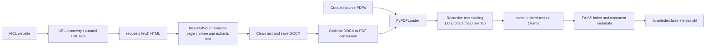
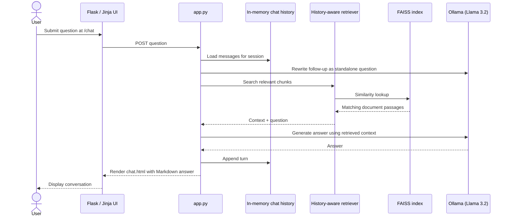

# Abuja Investments Company Limited (AICL) RAG Chatbot

A document-grounded conversational assistant for exploring publicly available Abuja Investments Company Limited (AICL) information. The project brings together web-data collection, document conversion, PDF parsing, semantic search, a locally served language model, and a lightweight Flask chat interface.

> **Project status:** This documentation describes the implementation in this repository. It is a portfolio/demo application, not a production-hardened service. See [Current limitations and production considerations](#current-limitations-and-production-considerations) before deploying it for real users.

## At a glance

| Area | Implementation |
| --- | --- |
| Web application | Python, Flask, Jinja templates |
| Knowledge sources | AICL website pages and PDF documents |
| Web extraction | `requests`, `BeautifulSoup`, `python-docx` |
| Document ingestion | LangChain `PyPDFLoader` |
| Chunking | LangChain `RecursiveCharacterTextSplitter` (1,000 characters, 200 overlap) |
| Embeddings | Ollama `nomic-embed-text` |
| Vector search | FAISS via LangChain Community |
| Answer generation | Ollama `llama3.2:latest` |
| User interface | HTML, CSS, Bootstrap 4, Jinja, Markdown rendering |
| Conversation context | LangChain message history in process memory |

## What the application does

The chatbot answers questions using a curated knowledge collection about AICL, its services, people, subsidiaries, investments, and news. At runtime, it looks up relevant passages in a FAISS vector index and sends those passages together with the user's question to a locally hosted Ollama model. The intended result is a concise, readable answer grounded in the documents rather than a general-purpose answer from the model alone.

The repository also contains a data-preparation workflow: discover or curate AICL website URLs, fetch and clean page text, save pages as Word documents, and optionally convert those documents to PDFs. The current Flask app loads PDFs from `scrapping_text/scraped_pdfs/`; the crawler and extraction scripts are separate preparation utilities, not routes exposed by the web app.

## Architecture

### End-to-end data preparation and indexing



### Question and answer flow



The code constructs the FAISS retriever once at application startup. For each chat request, it builds a history-aware retrieval chain using the prompt templates in `prompts.py` and invokes it with the fixed session ID `abc123`.

## Repository guide

```text
.
├── app.py                         Flask routes, PDF loading, chunking, FAISS, and RAG chain
├── prompts.py                     Follow-up question and answer prompt instructions
├── faiss/
│   ├── index.faiss                 Persisted vector index
│   └── index.pkl                   LangChain document-store / metadata companion
├── pdfs/                           Original AICL reference PDFs
├── scrapper/
│   ├── getLinks.py                 Same-domain link crawler
│   ├── extractor.py                Earlier website-to-DOCX extraction script
│   └── pages_name.txt              Curated website URL list
├── scrapping_text/
│   ├── extractor.py                Website fetch, cleanup, and DOCX export workflow
│   ├── doc2pdf.py                  DOCX-to-PDF conversion utility
│   ├── pages_name.txt              Curated URLs consumed by the extraction workflow
│   ├── scraped_docs/               Generated Word documents
│   └── scraped_pdfs/               PDFs loaded by the Flask application
└── templates/
    ├── index.html                  Landing page
    └── chat.html                   Chat form and conversation display
```

The repository also includes Python bytecode under `__pycache__/`; it is generated runtime output and is not part of the application workflow.

## How each part works

### 1. Source discovery and data engineering

- `scrapper/getLinks.py` crawls pages under `https://abujainvestments.com/`, keeps links on the same host, and writes discovered links to `scrapper/aiclpages.txt`. The crawl has a `max_pages` limit (100 by default).
- `scrapper/pages_name.txt` and `scrapping_text/pages_name.txt` are curated URL lists used as extraction inputs. The lists are not identical: they include different page selections.
- `scrapping_text/extractor.py` reads its URL list, requests each page with a browser-like user agent and a 10-second timeout, removes common page-chrome elements (`script`, `style`, `nav`, `footer`, `header`, `aside`), extracts visible text, normalizes whitespace, removes URLs and some non-ASCII/special characters, and writes a titled `.docx` into `scraped_docs/`.
- `scrapping_text/doc2pdf.py` converts `.docx` files in `scraped_docs/` to PDFs in `scraped_pdfs/`. It uses `docx2pdf`, which may require Microsoft Word on Windows/macOS; conversion environment requirements should be checked for your operating system.
- `scrapper/extractor.py` is an earlier, less robust extraction variant. The newer `scrapping_text/extractor.py` includes request timeouts, status checks, filtering of page chrome, safe filenames, an output directory, and per-page error handling.
- The root `pdfs/` folder holds three original reference PDFs. The Flask loader, however, currently reads PDFs from `scrapping_text/scraped_pdfs/` rather than directly from `pdfs/`.

This workflow demonstrates a practical ingestion pipeline: source discovery, extraction, normalization, file-format staging, and downstream indexing. For repeatable production ingestion, add source metadata, change detection, deduplication, logging, and validation before publishing new index versions.

### 2. Document parsing and chunking

In `app.py`, `get_document_loader()` walks `scrapping_text/scraped_pdfs/`, selects files ending in `.pdf`, and uses LangChain's `PyPDFLoader` to load their page content and metadata. `get_text_chunks()` applies `RecursiveCharacterTextSplitter` with:

| Setting | Value | Purpose |
| --- | ---: | --- |
| `chunk_size` | 1,000 characters | Keeps retrieved passages small enough to fit efficiently into model context |
| `chunk_overlap` | 200 characters | Retains context across adjacent chunks |
| `length_function` | `len` | Measures chunk size in characters |

Page/source metadata produced by the PDF loader is retained with chunks in the vector store. This metadata can support source attribution; the active web route does not currently render citations to users.

### 3. Embeddings and FAISS persistence

`get_embeddings()` uses `OllamaEmbeddings(model="nomic-embed-text")` to convert chunks into vectors and LangChain Community's FAISS vector store to index them. If `faiss/index.faiss` exists, the app loads the saved index. If it does not, it reads the PDFs, splits the text, creates embeddings, and saves the vector store to `faiss/`.

The saved index consists of `index.faiss` and `index.pkl`. Both files should be treated as a matched artifact and rebuilt together whenever the source documents or embedding model change. The index is not automatically refreshed just because a PDF changes while an existing index file remains present.

### 4. Retrieval-augmented generation

The main RAG components are wired in `app.py`:

1. `create_history_aware_retriever` combines the question with prior conversation context. `contextualize_q_system_prompt` in `prompts.py` instructs the model to rewrite follow-up questions as standalone questions without answering them.
2. The retriever searches the FAISS index for relevant document chunks.
3. `create_stuff_documents_chain` places retrieved content into the answer prompt. `qa_system_prompt` tells the model to answer from retrieved context, say when it does not know, and format lists/readable output in Markdown.
4. `create_retrieval_chain` connects retrieval and answer generation.
5. `RunnableWithMessageHistory` associates the conversation chain with LangChain `ChatMessageHistory` stored in the application's process memory.
6. The answer is converted from Markdown to HTML with the Python `markdown` package and passed to the chat template.

The language model is `ChatOllama(model="llama3.2:latest")`; embeddings use the separate `nomic-embed-text` model. Both models must be available to the Ollama service on the machine running Flask.

### 5. Web interface

- `GET /` renders `templates/index.html`, a landing page describing the document assistant and linking to chat.
- `GET /chat` renders the empty chat page.
- `POST /chat` reads the `question` form field, invokes the conversational RAG chain, appends the turn to a process-level list, and renders `templates/chat.html`.
- `templates/chat.html` renders the question and answer bubbles, auto-scrolls to the latest message, and uses Bootstrap 4 and Font Awesome assets from CDNs.

The interface is intentionally simple: users type a question and receive a formatted answer. The current project does not implement document uploads, despite the landing page's generic PDF-processing feature copy.

## Tools and libraries

| Tool / library | Role in this project |
| --- | --- |
| Python | Application and data-preparation language |
| Flask | HTTP routes and template rendering |
| Jinja | Generates the landing and chat HTML pages |
| Requests | Fetches pages from the AICL website |
| Beautiful Soup 4 | Parses HTML and extracts page text/links |
| `python-docx` | Writes extracted web content as Word documents |
| `docx2pdf` | Optional conversion of extracted Word documents to PDFs |
| LangChain Community | PDF loader, FAISS integration, and chat-history implementation |
| LangChain Core / Text Splitters / Classic | Prompts, document splitting, and retrieval-chain construction |
| LangChain Ollama | Connects the application to Ollama chat and embedding models |
| PyPDF | PDF page extraction used by `PyPDFLoader` |
| FAISS | Local vector similarity index |
| Ollama | Local model runtime for `llama3.2:latest` and `nomic-embed-text` |
| `python-dotenv` | Loads environment settings from a `.env` file when present; no required variable is currently read by the code |
| Python `markdown` | Converts model Markdown responses for HTML display |
| Bootstrap, jQuery, Popper, Font Awesome | Front-end styling and icon assets loaded from CDNs |

There is currently no dependency manifest (`requirements.txt` or `pyproject.toml`) in the repository. The import statements establish the dependencies above, but this repository does not pin their versions. LangChain's package boundaries and APIs change over time, so record and test a compatible dependency lock before relying on a fresh install.

## Setup and run

### Prerequisites

- Python 3.10+ recommended (the project does not specify or pin a Python version).
- Git.
- Ollama installed and running locally.
- Enough memory and disk space for the Llama model, embeddings, source PDFs, and FAISS index.

### 1. Clone the project and create an environment

```bash
git clone https://github.com/amsadeeq/GenAI_LLM_RAG_AICL_ChatBot.git
cd GenAI_LLM_RAG_AICL_ChatBot
python -m venv .venv
```

Activate it:

```bash
# macOS / Linux
source .venv/bin/activate

# Windows PowerShell
.venv\Scripts\Activate.ps1
```

### 2. Install application dependencies

The project has no committed dependency file. Install the packages used by the app (then pin the tested versions for repeatable deployment):

```bash
python -m pip install --upgrade pip
python -m pip install Flask python-dotenv markdown \
  langchain-core langchain-community langchain-classic langchain-text-splitters \
  langchain-ollama faiss-cpu pypdf
```

For the optional website extraction and conversion scripts:

```bash
python -m pip install requests beautifulsoup4 python-docx docx2pdf
```

`docx2pdf` conversion can need a compatible Microsoft Word installation depending on the platform. It is not required merely to run the chatbot if the PDF files are already available.

### 3. Start Ollama and pull models

Ensure Ollama is installed and its service is running, then make the model names used in `app.py` available:

```bash
ollama pull llama3.2:latest
ollama pull nomic-embed-text
```

The app currently uses Ollama's default local connection. No API key or `.env` setting is required by the checked-in application code.

### 4. Confirm knowledge files and run Flask

The runtime loader expects PDFs under `scrapping_text/scraped_pdfs/`. The repository includes prepared PDFs there. The saved vector index is under `faiss/`.

```bash
python app.py
```

Open <http://127.0.0.1:5000/> in a browser. The development server runs with Flask debug mode enabled in the current code; do not expose that configuration to the public internet.

### Rebuild the knowledge index

To force a fresh index, stop the app and move or remove both files in `faiss/` (`index.faiss` and `index.pkl`), then start the app again. It will rebuild from `scrapping_text/scraped_pdfs/`. This requires Ollama and the embedding model to be available. Keep a backup of the existing index before replacing it.

### Refresh website-derived documents (optional)

The extraction script uses paths relative to its working directory. Run it from `scrapping_text/` so it finds `pages_name.txt` and writes into the expected folders:

```bash
cd scrapping_text
python extractor.py
python doc2pdf.py
```

To discover links, run the crawler from `scrapper/`:

```bash
cd ../scrapper
python getLinks.py
```

The crawler output is `aiclpages.txt`; it does not automatically replace either curated URL list. Review and curate URLs before ingestion. After refreshing the PDFs, rebuild the FAISS index as described above.

## Example user journey

1. A visitor opens the landing page and selects **Start Chatting**.
2. The visitor asks a question about an AICL topic represented in the indexed PDFs.
3. The application uses chat history to interpret follow-up questions, retrieves matching passages, and asks the local model to formulate an answer from those passages.
4. The visitor sees a Markdown-formatted response in the chat view.

For a portfolio demo, choose a question whose answer can be verified in the included reference documents, then show the source PDF and the response side by side. The current chat page does not display retrieved citations, so do not present its answers as independently cited unless you add that feature.

## Outcomes and engineering capabilities demonstrated

This project is a practical end-to-end example of turning unstructured public information into a conversational search experience. It demonstrates:

- **Data engineering:** URL curation and crawling, HTML parsing, noise removal, normalization, file-format conversion, and preparation of document collections.
- **Document AI / RAG:** PDF ingestion, overlapping chunking, local embedding generation, vector indexing, semantic retrieval, and context-grounded language-model responses.
- **Application engineering:** a Flask app, request handling, template-based pages, Markdown response presentation, and conversation-aware interactions.
- **Local-first AI integration:** using Ollama for both generation and embeddings, with FAISS as a local vector store.
- **System integration:** connecting data collection, storage artifacts, retrieval, model prompting, and a human-facing interface into one demonstrable workflow.

The repository contains 39 curated AICL website URLs in `scrapping_text/pages_name.txt`, three original PDFs under `pdfs/`, and prepared website-derived Word/PDF artifacts under `scrapping_text/`. These are repository inventory counts, not a measured quality or performance result. No evaluation dataset, retrieval-quality benchmark, latency test, or user-study result is included, so answer accuracy and efficiency should be measured before making quantified claims.

## Current limitations and production considerations

These notes describe concrete characteristics of the current code and are important for an honest technical portfolio presentation:

- **Reproducibility:** there is no requirements file, lock file, automated test suite, or declared Python version. Pin compatible dependency versions and add smoke tests.
- **Index lifecycle:** a saved `faiss/index.faiss` is loaded without checking whether source documents or embedding models have changed. Add an explicit ingestion/reindex command and versioned index builds.
- **Persistence/security:** FAISS loading sets `allow_dangerous_deserialization=True` for the companion pickle. Only load index artifacts from trusted sources; untrusted pickle files can execute code when deserialized.
- **Session isolation:** the chat uses the hard-coded session ID `abc123` and module-level in-memory history. Users/processes are not isolated reliably, history disappears on restart, and this is not multi-worker persistence. Use secure per-user session identifiers and a durable store.
- **HTML safety:** generated Markdown is rendered with Jinja's `safe` filter. Sanitize model-generated HTML or use a safe Markdown configuration before serving it to untrusted users.
- **Development server:** `app.run(debug=True)` is for local development only. Use a production WSGI server, disable debug mode, and configure deployment secrets and network access appropriately.
- **Error handling and observability:** scraper errors are printed, and the web route does not have structured error responses or telemetry. Add structured logging, input validation, timeouts, and user-friendly failure handling.
- **Sources in answers:** `get_chain()` and `process_llm_response()` are separate from the active history-aware chain in the `/chat` route. The route returns answer text but does not show source names or page citations. Wire retrieved-document metadata into the UI if traceability is required.
- **Data quality:** HTML cleanup removes broad character classes and can discard meaningful symbols or non-English text. Add quality checks, retain page titles/URLs/timestamps, and review extracted content.
- **Crawling governance:** check the source site's terms and `robots.txt`, use a suitable crawl delay, and avoid unnecessary repeat requests when refreshing data.
- **Product copy:** the landing page mentions PDF uploads, but the code currently indexes files from a local directory and has no upload endpoint.
- **Evaluation:** build representative questions with expected source passages and track retrieval relevance, answer faithfulness, latency, and fallback behavior before describing the system as accurate or production-ready.

## Suggested next steps

1. Add `requirements.txt` or `pyproject.toml` with pinned, tested versions and a documented Python version.
2. Separate ingestion/index building from Flask startup so deployment does not unexpectedly process a large corpus.
3. Add source citations (document name and page) to responses and expose provenance in the interface.
4. Replace the fixed session ID and process-level history with per-user sessions and persistent storage.
5. Add automated tests for URL extraction, PDF loading, chunking, retrieval, and Flask routes.
6. Create an evaluation set and report measured retrieval/answer quality and response latency.
7. Harden deployment: safe HTML handling, production WSGI server, debug disabled, access controls, and trusted index artifacts only.

## License and data note

No license file is included in the repository. Confirm rights and permissions for the source website content and bundled documents before redistribution or commercial deployment. This documentation does not grant rights to third-party material.
